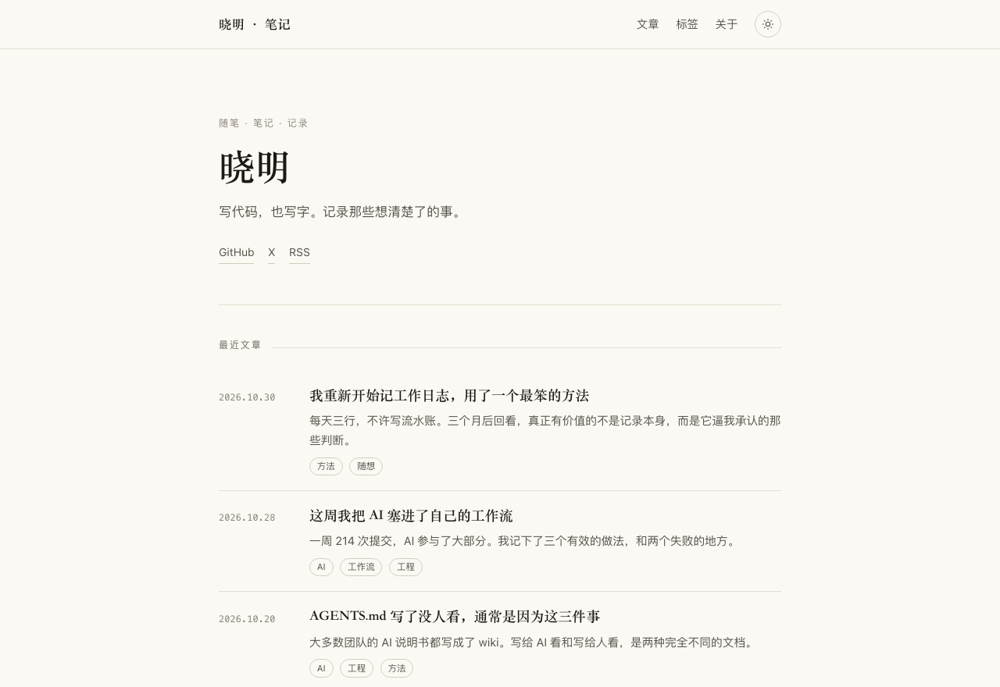
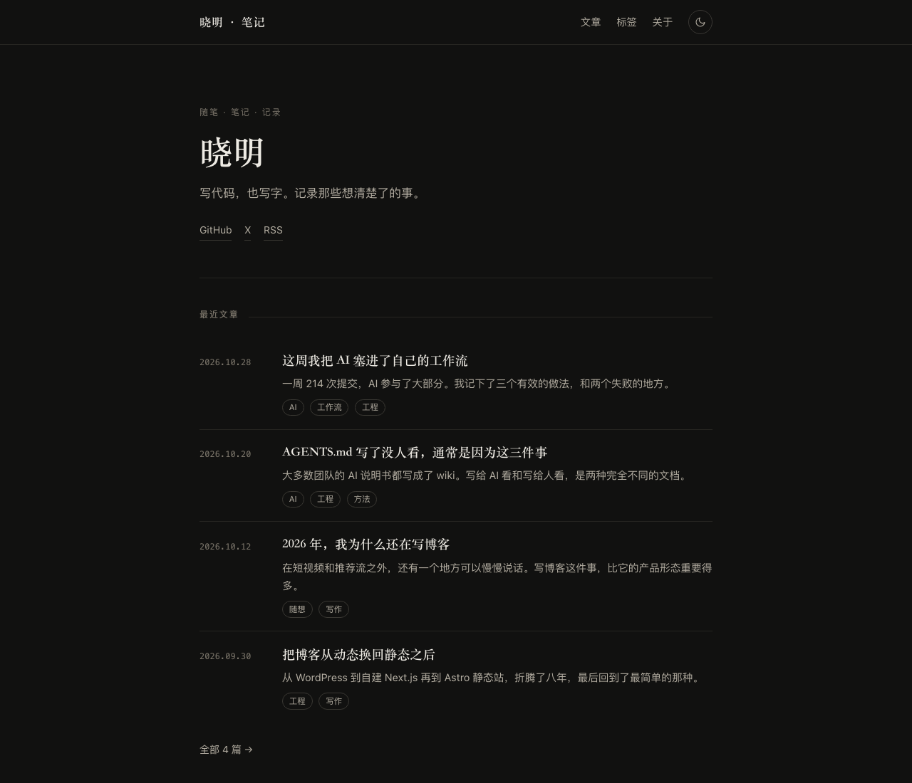
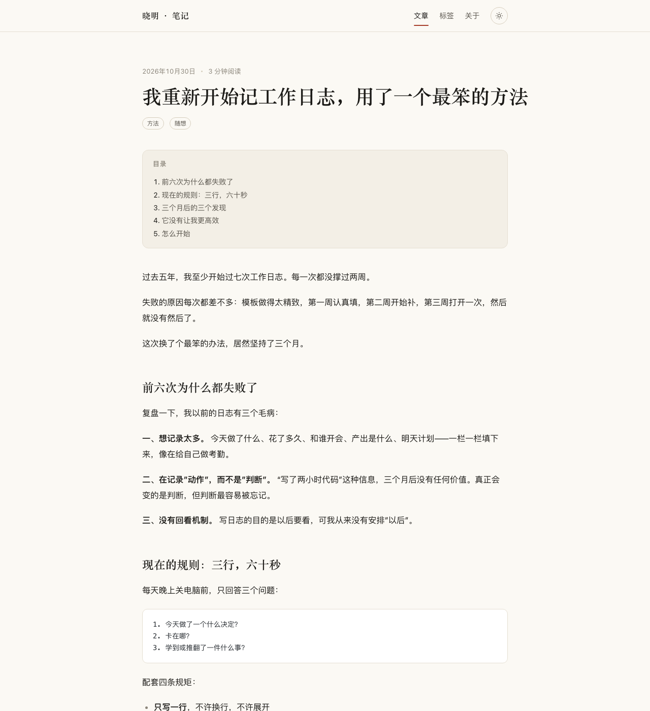

# 个人博客

一个纯静态的个人博客。Astro 6 + Markdown，没有数据库、没有后端、没有跟踪脚本。

- 浅色 / 深色主题，跟随系统，无闪烁
- 中文排版优化（宋体标题 + 系统无衬线正文）
- 文章目录、归档时间线、标签、RSS、Sitemap、404
- 构建产物自检：断链、SEO 基础项、RSS

## 预览

| 浅色 | 深色 |
| --- | --- |
|  |  |



## 快速开始

```bash
pnpm install
pnpm dev          # http://localhost:4321
```

构建与验证：

```bash
make verify       # 构建 + 自检（断链 / SEO / RSS）
pnpm preview      # 本地预览构建产物
```

## 写一篇文章

在 `src/content/blog/` 下新建 `<slug>.md`：

```markdown
---
title: 文章标题
description: 一句话摘要，会出现在列表页和 RSS 里
pubDate: 2026-10-30
tags: ["AI", "工程"]
draft: false
---

正文从这里开始。
```

- 文件名即 URL：`why-blog.md` → `/blog/why-blog/`
- `draft: true` 的文章不会被构建，也不会进 RSS
- 正文至少有一个 `##` 标题，文章页才会显示目录
- 标签自动汇总到 `/tags/`

## 改成你自己的

上线前把这四处换掉：

| 要改什么 | 文件 |
| --- | --- |
| 站点名、作者、简介、社交链接 | `src/consts.ts` |
| 域名（两处要一致） | `src/consts.ts` 的 `url`、`astro.config.mjs` 的 `site` |
| Sitemap 地址 | `public/robots.txt` |
| 图标 | `public/favicon.svg` |
| 示例文章 | 删掉 `src/content/blog/` 里不需要的 `.md` |

然后按自己的喜好调 `src/styles/global.css` 顶部的 CSS 变量——颜色、字体、内容宽度都在那里。

## 部署

### GitHub Pages（已配好）

1. 推送到 GitHub，仓库 Settings → Pages → Source 选择 **GitHub Actions**
2. 推送到 `main` 分支会自动构建部署（见 `.github/workflows/deploy.yml`）

> 如果仓库不是 `<用户名>.github.io`，需要在 `astro.config.mjs` 里加 `base: '/<仓库名>'`。

### 其他静态托管

Vercel / Netlify / Cloudflare Pages 都可以，构建命令 `pnpm build`，输出目录 `dist`。

## 目录结构

```
├── src/
│   ├── consts.ts          # 站点配置：先改这里
│   ├── content/blog/      # 文章（Markdown）
│   ├── content.config.ts  # frontmatter 校验规则
│   ├── components/        # 页头、页脚、文章卡片、目录、主题切换
│   ├── layouts/           # 页面骨架
│   ├── lib/posts.ts       # 文章排序、标签统计、阅读时长
│   ├── pages/             # 路由
│   └── styles/global.css  # 设计变量与排版
├── scripts/check.mjs      # 构建产物自检
├── public/                # favicon、robots.txt
├── AGENTS.md              # 给 AI 的项目说明书
└── Makefile
```

## 设计说明

- 配色以「纸墨」为基调：浅色是暖白纸，深色是墨黑
- 正文用系统无衬线字体保证中文可读性，标题用宋体制造编辑感
- 全站只有一处强调色（朱砂红），用在下划线、标签和链接上
- 不加载任何 Web 字体，首屏不依赖外网

## 许可

文章内容 CC BY-NC-SA 4.0；代码 MIT。
